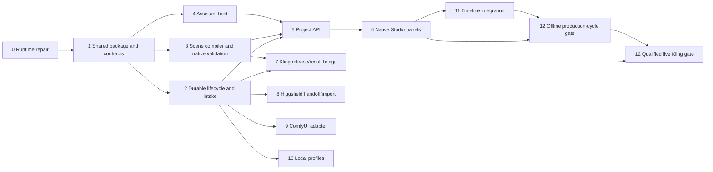

# Film Studio Execution Implementation Plan

> **For agentic workers:** REQUIRED SUB-SKILL: Use superpowers:subagent-driven-development to implement this plan task-by-task. The producer explicitly chose delegation. Parent integrates shared seams; workers own isolated modules. Steps use checkbox tracking.

**Goal:** Deliver the actual Hyperframes production frontend and assistant-assisted, parameter-validated scene workflow for The Table Between Centuries, with recoverable provider/candidate/edit integration.

**Architecture:** One public Studio, one shared production domain package and narrow typed host capabilities. AI proposes SceneBrief; deterministic services compile/validate; the canonical producer runner releases Kling requests. Existing renderer, editor and source authority remain.

**Tech Stack:** Existing Bun workspace, ESM/TypeScript, React/dockview, Hono, current workspace tsup/Vitest, Node filesystem/process primitives, existing FFmpeg/Hyperframes renderer. No new paid AI backend. Preserve audited ESM service algorithms during package extraction; do not simultaneously rewrite them into another state framework.

**Spec:** `film-studio/PRODUCTION-DESIGN.md` (review candidate; new product implementation starts after its single producer review). Independent builder check found nothing important left; private receipt `.film-workspace/production-planning/BUILDER-CHECK.md`.

## Global Constraints

- Use existing workspace build/export conventions; Bun only for workspace operations. No new dependency without a task-specific reason.
- Imported documents and historical request snapshots remain immutable evidence.
- Assistant output is an untrusted proposal; it cannot manufacture approvals, measured facts, capabilities or releases.
- Exact dialogue bytes must survive compilation. Unsupported parameters/assets/combinations produce diagnostics; no silent clamping, fallback or dropping.
- Keep the canonical Movies release runner as sole Kling submitter. Canonical Movies and Argon checkouts are read-only to implementation workers.
- No paid request, upload, real model inference or creative selection is authorized by plan acceptance alone.
- New local assistant host is explicit functionality; do not claim desktop chat code exists in this checkout. Codex is first in-app; Claude external handoff remains available, with in-app subscription mode gated by supported qualification.
- At most three implementation workers plus parent. Separate peer worktrees, never nested checkouts; no overlapping file ownership. Preserve concurrent `film-studio/WORKFLOW.mmd`.
- Docs ship with user-visible behavior; new CLI commands update `docs/packages/cli.mdx`. Tests must be reachable. Build changed packages before consumers.

## Contracts and ownership

Parent owns public contracts/export maps, workspace `package.json`/`bun.lock`, build ordering, package-subpath manifests, shared route registration, existing dock/App wiring, integration docs and final acceptance. Workers request seam edits rather than independently modifying these files.

`packages/film-production/src/contracts.ts` defines the V1 records in the spec plus the following ports:

- `FilmPort.readProject(projectId): Promise<ProjectViewV1>`
- `FilmPort.dispatch(projectId, command: FilmCommandV1): Promise<FilmCommandResultV1>`
- `FilmPort.events(projectId, afterSequence): AsyncIterable<FilmEventV1>`
- `AssistantPort.inspect(provider): Promise<AssistantReadinessV1>`
- `AssistantPort.start(context: AssistantContextV1, instruction): Promise<AssistantTurnV1>`
- `AssistantPort.events(turnId, afterSequence): AsyncIterable<AssistantEventV1>`; `cancel(turnId): Promise<void>`
- `ProviderPort.inspectReadiness(profileId): Promise<ProviderReadinessV1>`; `prepare(compilation): Promise<ProviderCandidateV1>`; optional `submit(release)`, `reconcile(attemptId)`, `importResult(receipt)` only when declared supported.

Every mutation carries requestId, projectId, expectedProjectRevision and explicit reason. Assistant-context includes immutable project/shot/composition/selection/playhead/revision identity. Event envelopes contain projectId, sequence, operation/turn ID and version; late events cannot retarget another project. All external JSON starts as unknown and is parsed before use; no `any`/unchecked assertions.

## Dependency waves

Wave 0: finish runtime repair and freeze contracts. Wave 1: domain lifecycle, compiler and assistant-host workers can run independently. Wave 2: API/frontend plus provider work consume reviewed contracts; backend and frontend integration are sequential where required. Wave 3: Higgsfield, ComfyUI and local profiles run in parallel against the same intake interface. Parent schedules one independent review per meaningful milestone, not per trivial edit. No worker waits for another's uncommitted implementation.

## Review Focus

- Source refresh/additive candidate must preserve old job/review provenance and identify only affected decisions; tests in Task 2.
- Tool-enabled or inherited-config assistant must not bypass provider release or mutate source; negative fake-process tests and qualification in Task 4.
- Shot/project switch during streamed response must not apply to the new target; tests in Tasks 5–6.
- Native schema/quote/reference drift after preview must invalidate exact release; tests in Task 7.
- Candidate replacement/edit/restart must preserve manual edits, dialogue bytes, frame timing and source metadata; tests in Tasks 2, 11–12.

## Task 0 — Coherent inspector runtime (existing-contract repair)

**Owner:** delegated runtime worker, branch `feat/film-runtime-consistency`, peer checkout; parent reviews and publishes.
**Files:** existing `scripts/film-production/inspector-server.mjs`, `inspector.test.mjs`, `film-studio/INSPECTOR.md` only.
**Interface:** unchanged `createInspectorServer`; a server owns a fixed complete asset snapshot.

- [x] Reproduce RED: replace assets before first request and remove required module; old code mixes live disk assets / starts partial UI.
- [x] Capture the fixed allowlisted assets at initialization; missing required asset fails before listening. Preserve security/API semantics.
- [x] Verify focused film suite (155 tests), lint/format and regression evidence. Parent reviews full diff.
- [ ] Commit/push scoped repair; preserve runtime review backup. A controlled real restart is a distinct operator action, not an automatic worker side effect.

Broader workspace run exposed failures outside the changed scope; do not relabel it green or fix unrelated packages inside this task.

## Task 1 — Shared package and contract freeze

**Owner:** parent integration plus one package worker; no other worker edits manifests/contracts.
**Files:** create `packages/film-production/{package.json,tsconfig.json,tsup.config.ts,src/contracts.ts,src/index.ts}` and explicit subpath entries; move current domain modules from `scripts/film-production/` into `src/legacy/` unchanged initially; retain compatible root CLI/re-export wrappers. Parent updates root build ordering, dependency manifests and package-subpath data.
**Consumes:** current audited service behavior. **Produces:** typed ports above, package exports usable from both Bun source and Node dist.

- [ ] Write failing package-consumer tests: existing CLI imports work, Node resolves built exports, browser-safe contracts import no fs/process implementation; no package cycle.
- [ ] Move single implementations and add boundary declarations/types without duplicating reducers. Preserve legacy file formats/commands. Parent commits the contract before consumer workers branch.
- [ ] Run `bun run --cwd packages/film-production build`, `bun run film:test`, `bun run check:workspace-contracts`, `bun run check:package-subpaths`, `bun run check:package-cycles`; expect baseline behavior and zero missing exports/cycles. Run a fresh workspace build once to establish the new package order. First isolate the recorded broad-workspace failures on the base under controlled load; do not hide failures or label an interrupted run green. Parent owns this baseline lane.
- [ ] Document public versus server-only exports; commit independently.

## Task 2 — Durable project lifecycle, revision continuity and candidate intake

**Owner:** domain worker. **Files:** new `src/project/{store,revisions,catalog,migration,attempts}.ts`, typed project parsers and `src/project/*.test.ts`; root wrappers retain compatibility.
**Consumes:** frozen contracts. **Produces:** `openProject`, `migrateLegacyProject`, `dispatchFilmCommand`, `registerCandidate`, `createAttempt`, implementing FilmPort.

- [ ] RED fixtures: restart after review save, add a take without losing old history, unrelated board-text update, changed reference bytes, stale concurrent mutation, interrupted publication, terminal failure/new attempt, unknown outcome/no duplicate, same native task bound once.
- [ ] Use locked atomic project state plus immutable content-addressed source/evidence blobs. Write blobs first, then publish references/revision; orphan blobs are harmless. Preserve legacy inputs; migration writes a new destination and never invents approval/compilation provenance.
- [ ] Keep source-evidence revision separate from effective creative/reference bindings. Preserve historical jobs on their captured snapshot; require revalidation of affected active proposals/releases. Candidate catalog additions are explicit events, not edits to old imported bundles.
- [ ] Intake verifies current bytes/streams, kind, original IDs, metadata and receipt/attempt provenance. Image metadata and first-frame review remain explicit. Model-generated files never become selected/accepted by registration.
- [ ] Run `bun run --cwd packages/film-production test src/project`; expect all listed recovery/data-continuity cases green plus legacy suite compatibility. Document operator migration/recovery; commit.

## Task 3 — Scene schema, patterns and deterministic Kling candidate compiler

**Owner:** compiler worker. **Files:** new `src/scene/{schema,compile,patterns,diagnostics}.ts`, `src/native/{snapshot,validate,serialize,releaseProfile}.ts` and their tests/fixtures; no domain store or transport edits.
**Consumes:** SceneBriefV1, verified reference bindings, source/review identity, optional CapabilitySnapshotV1, film release profile. **Produces:** `parseSceneBrief`, `compileScene`, `validateNativeCandidate`, `serializeCanonicalArgs` as specified.

- [ ] RED fixtures: exact Unicode dialogue, reordered object keys/determinism, invalid/overlapping action timing, contradictory camera, unknown required voice, missing references, unsupported sound/motion combination, wrong output arithmetic and malformed/unknown fields.
- [ ] Implement editable pattern data and prompt ordering from the spec. Adapt Argon pure compiler concepts with provenance/licensing retained; remove hardcoded model lists, time bounds and dialogue mutation. Distinguish prose lens/camera intent from native controls.
- [ ] RED native fixtures: model/enum/slot/schema drift, combined reference cap, alias collisions, incomplete snapshot, wrong runtime/source binding, duration/ratio/resolution/count mismatch. No snapshot means creative draft only, executable false.
- [ ] Verify `bun run --cwd packages/film-production test src/scene src/native`; expect deterministic output, useful field-level diagnostics and zero discovery/upload/submit calls. Compare canonical serialization/hash with the existing Python fixture. Document each pattern and diagnostic; commit.

## Task 4 — Proposal-only assistant host and external handoff

**Owner:** assistant-host worker. **Files:** new `packages/cli/src/film/assistant/{host,codex,externalClaude,events,context,qualification}.ts` and tests; parent wires host capability later. No UI/store/provider edits.
**Consumes:** AssistantPort/context and scene JSON schema. **Produces:** normalized readiness/start/events/cancel; candidate proposals only.

- [ ] RED fake-process cases: missing binary/login, unsupported protocol, bad JSON, output-schema violation, late chunks, cancellation, interruption, quota/rate limit, environment API-key override, unapproved tool request and token/log redaction.
- [ ] Resolve existing executables without installation/PATH mutation; use argument arrays and private project-scoped temporary context. Codex CLI structured output is the first adapter. Runtime compatibility and tool isolation must be tested before showing ready; no model call occurs during readiness browsing.
- [ ] Prove authoring mode cannot execute providers/shell/file writes or inherit unapproved MCP/hooks. If the verified version cannot enforce that profile, return unsupported with the external handoff path, not reduced protection. Never extract credentials.
- [ ] Implement Claude external file/clipboard handoff with the same scene schema/authoring instructions; do not advertise third-party Claude.ai login or silently use API billing. Any future embedded adapter must pass its documented qualification gate separately.
- [ ] Run CLI package tests for `src/film/assistant`; fake transports must show zero remote model/generation calls. Document supported modes versus unverified live auth; commit. Controlled real agent-turn acceptance is explicit, not hidden in unit tests.

## Task 5 — Shared project API and event bridge

**Owner:** API worker; parent owns `createStudioApi.ts`, `StudioApiAdapter` and CLI/Vite host wiring.
**Files:** new `packages/studio-server/src/film/{routes,assistantRoutes,validation,events}.ts` and tests; parent edits existing `types.ts`, `createStudioApi.ts`, `packages/cli/src/server/studioServer.ts`, `packages/studio/vite.adapter.ts`.
**Consumes:** FilmPort and AssistantPort. **Produces:** typed project GET/command/event and assistant readiness/turn/event/cancel endpoints under `/projects/:id/film/*` and `/projects/:id/assistant/*`.

- [ ] RED HTTP cases: wrong project/origin/token/type, oversized JSON/event, absent capability, stale revisions, event replay/cursor, disconnect/cancel and path escape.
- [ ] Register narrow routes through optional adapter capabilities. Vite defaults disabled/fake. Reuse existing Hono/SSE patterns; no arbitrary executable/path endpoint and no private state through generic editor routes.
- [ ] Build film-production then studio-server before CLI/Studio consumers. Run studio-server film-route tests and existing selection/media/host compatibility tests; expect unavailable mode explicit and existing API unchanged. Document route schemas and error recovery; commit.

## Task 6 — Native Studio Production and Assistant panels

**Owner:** frontend worker under `packages/studio/src/film/{components,hooks,api,context}` and tests. Parent wires `components/dock/panelRegistry.ts`, `hooks/useStudioSidePanels.tsx`, `hooks/useAskAgentModal.ts`, `App.tsx` minimally.
**Consumes:** reviewed API schemas, ProjectView, scene/compilation/assistant/provider states. **Produces:** actual functional dock panels, not an iframe of the companion inspector.

- [ ] Before UI work, read Studio AGENTS, Impeccable and current web guidance; retain existing tokens/components. RED UI cases: exact selected shot resolution, malformed assistant proposal, durable draft/reload, capability unavailable, keyboard, project switch/late response, stale apply/draft retention.
- [ ] Build shot/reference/direction context, structured scene editor/pattern choice, compiled prompt/native parameter inspector and diagnostics, attempts/candidates and explicit actions. Native parameter fields derive from the selected snapshot; no static model catalog or false ready status.
- [ ] Route existing Ask Agent into the one panel; preserve clipboard fallback. Show target/revision and editable proposal diff before apply. Generation/release actions are separate from chat send and cannot be triggered by model text.
- [ ] Run Studio film/AskAgent/dock tests and a real browser walkthrough through iframe/selection hooks, desktop+narrow layout and project reopening. Verify actual API, not only happy-dom mocks. Document public Studio support separately from desktop docs; commit.

## Task 7 — Kling qualification, exact release and result binding

**Owner:** Kling integration worker. **Files:** new package `src/providers/kling/{capabilities,prepare,releaseBridge,reconcile}.ts`, CLI host adapter and fixtures; parent updates old handoff wrapper. Canonical Movies files remain unchanged.
**Consumes:** compiled scene, snapshot, job/attempt, reference proofs and canonical release profile. **Produces:** blocked prepared payload, exact release input, single-submit bridge and normalized result receipts/candidates.

- [ ] RED fixtures: plugin versus canonical CLI identity mismatch, invalid producer-safe ID, missing/current schema, wrong input role, changed prompt/contract/bytes after release, expired quote/upload scope, interrupted submit and uncertain result.
- [ ] Qualify installed canonical transport and sanitized account-specific schemas using read-only operations; never substitute another CLI/MCP envelope. Bind both compilation fingerprint and canonical Python payload hash. Current film shot-contract restrictions remain explicit diagnostics.
- [ ] Only the canonical released request submits. Preserve native task/trace/output identity, reconcile unknown instead of retrying, verify downloaded bytes before intake. A deliberate new attempt requires explicit reason and a new exact release.
- [ ] Run offline provider/hash/runner-sentinel tests plus legacy handoff tests; expect no provider invocation from preparation. Live account readiness and one paid generation are separate producer-controlled gates. Document qualified versus fixture-only evidence; commit.

## Task 8 — Higgsfield handoff and owned-result module

**Owner:** provider worker A. **Files:** `src/providers/higgsfield/{handoff,receipt,qualification}.ts` and fixtures; no direct Studio wiring.
**Consumes:** provider/scene/candidate contracts. **Produces:** functional handoff package, explicit returned-media import, readiness capability declaration.

- [ ] RED missing/changed output, image metadata, wrong shot/job/attempt and false-executable-capability cases.
- [ ] Implement manual handoff/import as a usable production path. Automatic execution requires a documented authenticated product interface; an agent plugin alone is not that interface. Mark unsupported operations precisely, retain full request/output provenance.
- [ ] Run provider/intake tests; parent verifies generic UI exposes handoff/import correctly. No credits spent or uploads triggered. Document the execution qualification prerequisite; commit.

## Task 9 — ComfyUI workflow adapter

**Owner:** provider worker B. **Files:** `src/providers/comfyui/{profile,workflow,adapter,receipt}.ts` and fake-server tests.
**Consumes:** versioned selected server/workflow/input bindings, resource lease and provider contracts. **Produces:** readiness, deterministic workflow candidate, explicit queue submission/reconciliation and verified candidate result.

- [ ] Fetch current official/local server API documentation before implementation. RED fake-server cases: offline server, workflow drift, missing model/node, bad slot binding, queue disconnect/unknown, duplicate callback, escaping output and GPU lease conflict.
- [ ] Never start the server or download/load models from browsing/readiness. Bind workflow hash/model/input references to attempt; preserve server job ID and import outputs through shared intake.
- [ ] Run fake-server/provider tests with zero inference. A real queued workflow is a separate explicit local-generation acceptance. Document profile setup/recovery; commit.

## Task 10 — Local assistant/model profiles

**Owner:** provider worker C. **Files:** `src/providers/local/{profile,readiness,assistant,resources}.ts` and tests; local media uses Task 9 workflows where applicable.
**Consumes:** explicit configured runtime/model capabilities and shared resource lease. **Produces:** local SceneBrief proposals and honest media capability mapping.

- [ ] RED unavailable model, unsupported structured output, unexpected remote endpoint, server loss, schema-invalid proposal and competing Comfy/local resource cases.
- [ ] Keep endpoint/model/profile selection explicit; no weights install or auto-load. Validate every returned proposal with the same scene parser. No second independent local media engine.
- [ ] Run fake-runtime tests; then an operator-selected installed model can qualify actual behavior. Document limits and resource ownership; commit.

## Task 11 — Candidate-to-timeline actions through existing editor machinery

**Owner:** editor integration worker, using reviewed candidate contracts. **Files:** new `packages/studio/src/film/timeline/{mapping,placement,actions}.ts` and tests, shared package placement adapter; parent owns existing editor wiring.
**Consumes:** selected candidate/shot, explicit cut/timing, expected source/edit version. **Produces:** new-assembly action and explicit version-checked placement/replacement through existing SDK/mutation/undo paths.

- [ ] RED ID alias mismatch, stale source/clip, other human-edited clips, dialogue preservation, independent J/L audio, undo/reopen and rejected overwrite cases.
- [ ] Preserve original shot/take/attempt metadata on clips. Reuse existing preparation/placement and persistent edit-history paths; no new timeline authority. Editing never silently regenerates footage or re-prepares over hand edits.
- [ ] Run film placement and Studio editor integration tests, lint/check generated HTML, and real browser edit→undo/reopen acceptance. Document supported edit semantics; commit.

## Task 12 — Production-cycle and release gates

**Owner:** independent QA worker after the milestone's implementation review; parent integrates fixes.
**Files:** dedicated offline acceptance runner/fixtures under `scripts/film-production/acceptance/`, registered test/CI entrypoints, dated evidence under ignored workspace. Parent owns CI config.
**Consumes:** actual Studio/API/host/domain/provider/editor build. **Produces:** reproducible pass/fail report with separate offline, authenticated-assistant, local-generation, live-provider and creative gates.

- [ ] RED first: owned candidate cannot complete current register→select→edit→render→reopen loop; keep source copies and selections explicit, not guessed from legacy conflicts.
- [ ] Prove persistence/revision/failure recovery and the complete offline Galileo-style exchange through actual UI. Include malicious assistant output, unknown submission, source refresh and project switch.
- [ ] Decode exported frame count/duration and known boundary frames; compare expected independent audio timing/mix. Exercise 0.5x/2x only after native rate semantics are proved; otherwise expose unit-rate support honestly. No claim based only on HTML attributes.
- [ ] Add CI that runs the new package, affected Studio/API/CLI checks and the offline browser gate. Remote status must be read after publication; do not label empty check lists green.
- [ ] After offline success, qualify selected existing agent account without changing billing; live generation follows exact producer release. Creative scene/identity/voice/continuity acceptance stays the producer's decision.

## Completion and reporting

For every worker: read spec+own task, verify checkout/base, write meaningful regression first, implement within owned files, lint/format, report commands/results/limitations and commit only owned work after parent review. No worker reverts another's diff. Parent validates milestone integration before opening/updating draft PRs in `andreathar/hyperframes-film-studio`; no automatic PR merge.

Board cards track actual stage. Existing adapter/compiler/intake cards are reused. Add assistant host, shared package and API wiring cards because they are newly verified missing modules. Historical plans/delivery records stay historical; this plan is the current execution map after approval.
