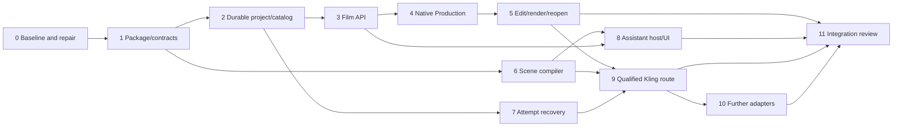

# Integrated Film Studio Implementation Plan

## Consolidation update — 2026-10-31

The producer requires one GitHub branch, `main`. The coordinator is consolidating existing heads and quality correction `48693f33f`; publication, remote branch cleanup and final integrated checks remain pending verification. Earlier branch/PR inventories are historical captures. [Project controls](PROJECT-CONTROL.md) and [the state register](PROJECT-STATE.json) record the verified backup and current policy. Recovery/input/descriptor findings, native offline acceptance, assistant/provider qualification and inspector activation remain open; consolidation does not close them.

> **For agentic workers:** Use superpowers:subagent-driven-development to execute reviewed tasks. The producer requested specialized subagents. The coordinator integrates shared seams; workers own isolated modules. Checkboxes describe this revision, not historical delivery.

**Goal:** Make the existing film tools one intuitive, recoverable workflow inside Hyperframes Studio, then add explainable scene assistance and qualified provider execution.

**Architecture:** One editor/renderer, one film domain package, one project store, optional film/assistant/provider capabilities. First close the owned-media candidate → selection → edit → render → reopen cycle. Compiler and assistant work can progress behind reviewed contracts without blocking the offline cycle.

**Tech Stack:** Existing Bun workspace, ESM/TypeScript, React/dockview, Hono, workspace build/test tools, Node filesystem primitives, existing Hyperframes/FFmpeg pipeline. Preserve audited algorithms during extraction.

**Spec:** [PRODUCTION-DESIGN.md](PRODUCTION-DESIGN.md), with delivery and interaction requirements revised below. [CHECKPOINT-REVIEW.md](CHECKPOINT-REVIEW.md) records fresh evidence. This is a new review proposal; no product implementation is claimed.

## Verified starting point — 2026-10-31

- Integration checkout: `docs/film-production-execution`, `658f01cd0`. Latest functional increment: inspector job controls, on top of import/review/jobs/blocked handoff/new-composition placement.
- Runtime repair: committed separately at `3532efca9`, `feat/film-runtime-consistency`, peer worktree `/mnt/data/Projects_SSD/hyperframes-film-kling-handoff`. It is absent here. Integration and activation are distinct actions.
- Fresh `bun run film:test`: **153/153** here; **155/155** in the peer repair checkout, no failures/skips. Whole-workspace baseline remains unresolved; the earlier broad run was interrupted.
- Whole-project reconciliation: [PR #7](https://github.com/andreathar/hyperframes-film-studio/pull/7), head `963d9b424`, already implements shared package/contracts and includes runtime repair ancestry. It is not in this checkout; review requires changes and CI Comments is failing. Reuse this work before assigning P1. Unified project/review/catalog, film API, native panels, compiler and assistant host remain unimplemented in the audited snapshots.
- New finding: synthetic directory-open failure after ledger rename rejected the mutation while reread showed revision 0 → 1. A failed response does not prove nothing was saved.
- Preserve concurrent `film-studio/WORKFLOW.mmd`. No merge, restart, provider action or model execution occurred in this review.

The [quality audit](QUALITY-REPORT.md), [observed state register](PROJECT-STATE.json) and [operating contract](PROJECT-CONTROL.md) now govern state reconciliation. First reconcile PR #7, contract changes and CI; use one implementation/integration lane plus independent review until that gate is closed. Later dependency waves retain the maximum three-worker cap.

## Global constraints

- Use existing workspace build/export conventions; Bun only for workspace operations. No new dependency without a task-specific reason.
- Imported documents and historical request snapshots remain immutable evidence.
- Assistant output is an untrusted proposal; it cannot manufacture approvals, measured facts, capabilities or releases.
- Exact dialogue bytes must survive compilation. Unsupported parameters/assets/combinations produce diagnostics; no silent clamping, fallback or dropping.
- Keep the canonical Movies release runner as sole Kling submitter. Canonical Movies and Argon checkouts are read-only to implementation workers.
- No paid request, upload, real model inference or creative selection is authorized by plan acceptance alone.
- Keep private production state outside editor-readable composition roots. No credentials in browser context, arguments or logs.
- At most three implementation workers plus coordinator. Separate local worktrees, `main` as the only published GitHub branch, explicit ownership, no reverting others' changes. No additional agent tiers by default.
- Reuse public Studio preview, timeline, asset browser, save/version checks and undo. Preserve external agent/file/clipboard authoring.
- Docs ship with behavior; new CLI commands enter `docs/packages/cli.mdx`. Tests must be reachable. Build changed packages before consumers.
- Read current applicable skills at execution time. Use the required Context7 flow for library/API/CLI integration documentation. This local review did not qualify external APIs/accounts.

## Approaches and recommendation

The design considered expanding the companion, integrating native Studio panels, and relying on unavailable desktop chat source. Native Studio remains the recommendation: reuse one editing context and one set of domain rules. Maintain the companion while native work is incomplete. Desktop chat is not an implementation baseline in this checkout.

Revise delivery order: the previous combined API dependency indirectly made compiler/assistant completion a prerequisite for the offline gate. Split optional capabilities so owned-media production works while assistant/provider readiness is unavailable. This is the coordinator's proposed sequencing change, not a recorded producer choice.

## Six concrete smart features

| Feature                        | Observable behavior                                                                                               | Recovery and acceptance                                                                                                |
| ------------------------------ | ----------------------------------------------------------------------------------------------------------------- | ---------------------------------------------------------------------------------------------------------------------- |
| Resume and next action         | Reopen the same shot/draft; show the highest-priority unresolved step with reason and field link                  | Derive from diagnostics, never guessed mappings; retain both conflict versions; announce status without stealing focus |
| Reference/continuity guidance  | Assigned references first, role/subject filters, explain suggestions and changed continuity inputs                | Use recorded evidence/hashes; no automatic assignment; invalidate affected proposals when bytes change                 |
| Guided scene brief             | Editable acting beats, camera intent, exact dialogue and readable frame timing; inspect prompt/native diagnostics | Offline drafting works; unknown capability stays unresolved; no silent translation/model/time substitution             |
| Contextual assistant proposals | Explain diagnostics or draft changes; preview before/after diff and explicitly apply                              | Freeze project/shot/revision; stale response stays a draft; cancel/reconnect cannot retarget another shot              |
| Candidate comparison/placement | Compare media/notes; preview track/start/trim/rate/audio before assembly or edit                                  | Separate validity from selection; preserve previous edit; keyboard operation and undo/reload proof                     |
| Job readiness/recovery         | Clear manual/qualified/unavailable modes and release/submitted/unknown/returned/failed states                     | Reconcile the same unknown task; new attempt has lineage/release; readable labels with inspectable IDs                 |

Use existing tokens/components. Show one primary next action; disclose provenance/settings when needed. Pending state affects its operation, not unrelated browsing. Keyboard access, textual status, live announcements and focus recovery are acceptance requirements. Uncertain saves show “Checking saved state”; never claim saved before publication is confirmed.

## Specialized team and ownership

Planning used three independent read-only specialists: architecture/domain, workflow/UX, reliability/code quality. Execution schedules these roles in waves, not all simultaneously.

| Role                           | Owns                                                                                                                        | Boundary                                                       |
| ------------------------------ | --------------------------------------------------------------------------------------------------------------------------- | -------------------------------------------------------------- |
| Coordinator/integrator         | Contracts, exports, manifests/lockfile, build order, existing API/host/dock/Ask Agent/editor wiring, docs/final integration | No canonical source mutations or unrelated edits               |
| Domain specialist              | New package `src/project/`, later `src/attempts/`, tests                                                                    | No UI/transports or unilateral contract changes                |
| API specialist                 | New studio-server `src/film/` routes/session/events/tests                                                                   | Registration files remain coordinator-owned                    |
| UX/frontend specialist         | New Studio `src/film/` components/hooks/API and assistant UI                                                                | One UI state owner; no domain reducers/host execution          |
| Compiler/assistant specialists | Compiler: package `src/scene/`, `src/native/`; host: CLI `src/film/assistant/`                                              | Separate ownership; frontend integration stays with UI owner   |
| Provider specialist            | One assigned provider module and narrow host adapter                                                                        | No second submit authority or provider-specific frontend store |
| Independent reviewer/QA        | Milestone review/evidence; runner/scenarios when assigned                                                                   | Fixes return to implementation owner                           |

Freeze a contract commit before consumer integration. Contract changes are coordinator patches followed by affected-consumer validation. Workers report base SHA, owned diff, commands/results, unresolved issues and interfaces. Review meaningful milestones. Same failing scenario is rechecked after its owner fixes it.

## Contracts to freeze before parallel consumers

Review PR #7's existing `packages/film-production/src/{contracts.ts,model.ts,parse/,browser.ts,index.ts}` and server-only legacy subpath. Preserve that implementation and browser-safe entrypoints; do not create parallel parser/server modules just to match earlier proposed filenames. Browser imports cannot transitively load fs/process.

PR #7 has the main ports and parsed command actions, but its command lacks the proposed envelope version and its result has `accepted: boolean`, not the recovery discriminants below. These are requirements to reconcile before freeze, not evidence that the PR violated an already-approved revised contract. Review/draft/migration/placement actions and request replay must be settled against the existing types.

- Retain the design's V1 project/source/candidate/review/brief/compilation/capability/attempt/receipt/assistant records. Document legacy JSON migration without upgrading observations into authenticated provider proof.
- `FilmPort.readProject(projectId): Promise<ProjectViewV1>`; `dispatch(projectId, command: FilmCommandV1): Promise<FilmCommandResultV1>`; `events(projectId, afterSequence): AsyncIterable<FilmEventV1>`.
- Command envelope: `version: 1`, `requestId`, `projectId`, `expectedProjectRevision`, `reason`, discriminated `action`. Freeze exact review/draft/source-refresh/candidate-registration/selection/assembly payloads and parsers before API/UI consumer integration.
- Request identity is project-scoped and durable. Same ID/payload returns the recorded result; same ID/different payload conflicts. Check recorded requests before stale-revision rejection so lost responses can recover committed commands.
- Result discriminant: `applied`, `conflict`, `rejected`, `uncertain`, with request ID, current/observed revision and structured diagnostics. Uncertain never means blind retry. Reread by request ID; visible state after sync failure is not crash-durability proof. Block dependent writes until recovery verifies/republishes durable state or reports operator repair required.
- Diagnostics carry stable `code`, `severity`, `message`, optional `shotKey`, `fieldPath`, proposed recordId, typed recovery action. Distinguish invalid input, stale revision, unavailable capability, missing evidence, uncertain publication.
- Source evidence, additive catalog and project mutation revisions are separate. History retains original snapshots; refresh returns an impact set for affected active proposals/selections/releases.
- New intent identity includes project/shot and effective inputs. Legacy fingerprints remain history. Separate readable labels from route-safe IDs.
- Placement carries `requestId`, proposed operationId, expected project revision and expected composition file version across the editor/store boundary. Freeze `FilmPlacementCommandV1` in this contract commit; repeated application must reconcile the original operation, never insert twice.
- Events carry version/project/sequence/request-or-turn/revision. Replay committed project events from cursor; unavailable/expired cursor requires explicit resync plus snapshot, never silent gaps. Assistant events are independently optional.
- AssistantPort and ProviderPort retain design readiness/start/events/cancel and prepare/reconcile boundaries. FilmPort works without either.

## Dependencies and first delivery

Wave 0: review/integrate repair and classify baseline; contract design can proceed without changing a live inspector. Wave 1: domain P2 and compiler P6 independently follow P1. Wave 2: P3 → P4 → P5 is the offline critical path; P7/P8 use remaining slots and never block it. UI may develop against frozen fixtures while API settles, but acceptance uses the real API. Wave 3: one Kling route, then further adapters. Independent review runs when implementation workers free a slot.

## Review focus

1. Response loss/failure after state replacement: reconcile same request, retain evidence, verify durability before dependent work (P2/P3).
2. Additive candidate/changed reference: preserve history, invalidate affected current decisions only (P2/P4).
3. Project/shot switch during save/stream: retain drafts and reject target/revision mismatch (P4/P8).
4. Unknown outcome versus failure: reconcile original task versus explicit new attempt; no accidental cross-shot collision (P7/P9).
5. Edit changed after placement preview: reject stale apply, preserve manual changes/undo, verify decoded rate/trim/audio (P5).

## P0 — Actual baseline and existing runtime repair

**Owner:** coordinator; scoped runtime worker only if review finds a defect. **Files:** repair's `scripts/film-production/inspector-server.mjs`, `inspector.test.mjs`, `film-studio/INSPECTOR.md`; private evidence `.film-workspace/integration-baseline/`.

- [ ] Recheck worktrees and repair `3532efca9`. Its commit exists: do not redo it. Integrate the reviewed three-file change through the development branch; no automatic PR merge or live restart.
- [ ] Run `bun run film:test`; both asset regressions present, zero failures/skips, expected count at this point 155.
- [ ] In isolated execution worktrees, install frozen dependencies only if needed; `bun run build` before package tests/typecheck. Recover exact failures from the interrupted broad run; compare base `5ff23acdd` and candidate with identical setup/load. Interrupted/missing-dependency runs are not pass.
- [ ] Record command/base/candidate/result/owner. Fix candidate regressions in owning tasks; reproduced unrelated base failures get explicit follow-up, never silent suppression.

**Acceptance:** repair integrated and targeted regressions pass; named baseline failures reproducibly classified. Live restart remains a separate authorized operator action after preserving current review.

## P1 — Review/reuse the existing shared implementation and reconcile contracts

**Owner:** existing PR #7 implementation owner, session assignment to confirm; coordinator owns contract reconciliation/manifests and independent reviewer owns closure. **Files:** existing PR #7 package, `src/{contracts.ts,model.ts,parse/,browser.ts,index.ts,legacy/}`, package/consumer tests and current script wrappers. Preserve one implementation and build/export/subpath compatibility.

**Interfaces:** produces contracts above and server-only legacy exports; current CLI behavior stays compatible.

- [x] Existing extraction identified/reviewed at `963d9b424`; nine modules byte-identical, inspector asset path adjusted, old wrappers re-export one implementation. Isolated package build/four tests/typecheck and 155 legacy film tests pass; no fresh whole-workspace install qualification claimed.
- [ ] Close PR #7 path-contract, metadata/test-quality and failed Comments findings; reconcile Fallow exclusion scope. Recheck targeted consumer fixtures and added boundary regressions without duplicating the package.
- [ ] Reconcile versioned commands, uncertain outcomes, durable request replay and placement operation identity against existing ports/types; freeze one agreed contract commit and examples before consumer integration. Preserve file formats/storage algorithms until their owning lifecycle task changes them.
- [ ] Build new package and workspace in updated order. Run `bun run film:test`, `bun run check:workspace-contracts`, `bun run check:package-subpaths`, `bun run check:package-cycles`; zero new failures. Make package tests reachable through declared runners.
- [ ] Independent behavior/isolation review, then scoped commit as the consumer base.

## P2 — Durable project/review and additive catalog

**Owner:** domain specialist. **Files:** new package `src/project/{store,publication,revisions,catalog,migration,commands,nextActions}.ts`, tests/fixtures.

**Interfaces:** FilmPort through `openProject`, planned dispatchFilmCommand and readProjectEvents functions; `registerCandidate`/`selectCandidate` consume frozen actions and preserve legacy snapshot identity.

- [ ] RED: review/draft save → reopen; response-loss replay; same ID/different payload; competing revisions; unchanged/additive/changed source; intake → selection; duplicate bytes with explicit shot associations.
- [ ] RED publication faults before rename, directory-open/sync after rename, cleanup; crash/reopen with abandoned lock; orphan/missing blob. Assert no guessed rollback, blind retry or lock stealing.
- [ ] Implement private locked atomic project state and immutable blobs. Verify/write blobs before references; persist command outcomes. After uncertain publication, verify or durably republish visible state under writer ownership, otherwise block with diagnostic. Reread alone never proves power-loss durability.
- [ ] Intake verifies bytes, kind/stream coverage, original IDs, image metadata and optional job/attempt evidence. Catalog addition does not mutate imports, select or approve footage. Migration writes a new destination, preserves originals.
- [ ] Pure `deriveNextActions(view: ProjectViewV1): FilmNextActionV1[]`: uncertainty first, then stale/missing evidence, mapping/reference gaps, selection/placement. Stable priority, reason/target, no inferred mapping.
- [ ] Run `bun run --cwd packages/film-production test src/project`, legacy suite, build/typecheck; review fault results and migration/recovery guide.

## P3 — Optional film API and recoverable client contract

**Owner:** API specialist; coordinator owns registration. **Files:** new studio-server `src/film/{routes,session,events,validation}.ts` and tests; coordinator edits existing `types.ts`, `createStudioApi.ts`, CLI `src/server/studioServer.ts`, Studio `vite.adapter.ts`.

**Interfaces:** optional `StudioApiAdapter.film: FilmPort`; snapshot/command/events/bootstrap under `/projects/:id/film/*`. Assistant routes independently unavailable until P8.

- [ ] RED HTTP: missing capability, wrong project/Host/Origin/token/type, bounded payloads/events, path escape, stale revision, replay/lost response, cursor resync; private state inaccessible through existing generic file/media routes.
- [ ] Implement bootstrap/typed results/shared parsers, no arbitrary path/executable route; default Vite disabled/fake. Snapshot or narrow request lookup resolves uncertain outcomes by request identity.
- [ ] Build film then studio-server before consumers. Run `bun run --cwd packages/studio-server test src/film`, existing selection/host tests, affected typechecks; zero new failures versus P0.
- [ ] Document unavailable/recovery semantics and independently review routes before real host wiring.

## P4 — Native Production: open, decide, save, reopen

**Owner:** frontend specialist. **Files:** new Studio `src/film/{api,components,hooks,context}/` and tests; coordinator minimally wires `components/dock/panelRegistry.ts`, `hooks/useStudioSidePanels.tsx`, `App.tsx`.

**Interfaces:** consumes ProjectViewV1, diagnostics/actions and film HTTP; one project-scoped client store. No localStorage as canonical production persistence.

- [ ] RED: clip → explicit shot lookup, unmapped selection, saved/dirty/uncertain/conflict states, draft reload, switch project/shot during save, late response isolation, absent capability.
- [ ] Build shot/direction, assigned-first references/filters, explicit mapping/reference changes, owned candidate registration/selection, next-action links. Draft keyed project/shot/field; conflict preserves local and saved values. One truthful save contract for review/jobs.
- [ ] Scope pending state; use native tokens/components, keyboard controls, labels/live status and focus continuity. Narrow dock remains operable; readable labels reveal IDs/provenance on demand.
- [ ] Run `bun run --cwd packages/studio test src/film`, dock tests/typecheck. Actual browser + API: open synthetic project → reference change → owned intake/selection → reload/reopen; competing edit and keyboard recovery. Capture before/after, supported themes and narrow panel.

**Acceptance:** durable native review/candidate work without connected assistant, provider execution or companion download.

## P5 — Candidate-to-edit and first offline production cycle

**Owner:** editor specialist; coordinator owns existing mutation/undo seams. **Files:** new Studio `src/film/timeline/{placement,actions,preview}.ts`, tests; shared `src/project/{assembly,placementOperations}.ts`; a planned offline-cycle browser runner, isolated fixtures. Editor specialist owns these two shared files as an explicit exception to the domain directory ownership; domain specialist owns project-command reconciliation. Coordinator registers runner/CI.

**Interfaces:** pure `previewFilmPlacement(input: FilmPlacementInputV1): FilmPlacementPreviewV1`; `applyFilmPlacement(command: FilmPlacementCommandV1)` uses existing editor version/transaction machinery. Command includes preview, request/operation IDs and expected project/file versions, frozen during P1. New-assembly preparation remains supported separately.

- [ ] RED: catalog candidate resolves verified bytes; preview track/start/trim/rate/audio/conflicts; stale file/source rejects; existing hand-edited output never overwritten.
- [ ] New assembly first, then explicit insertion/replacement through existing save tokens/undo. Keep picture muted with separate dialogue. No second timeline state engine or arbitrary panel HTML rewrite.
- [ ] Persist placement intent before changing composition files. A durable operation receipt links preview/input identity, before/after file versions and hashes, resulting composition/clip IDs and editor transaction identity. After file mutation, reconcile that receipt into the project store; do not pretend the two stores share an atomic transaction. Restart/replay inspects recorded evidence and recovers the original result, or exposes uncertainty and blocks duplicate application. Never overwrite intervening human edits to resolve uncertainty.
- [ ] Fault tests interrupt before/after editor mutation and before/after project-result publication. Assert one insertion at most, recovery of the original receipt where provable, explicit uncertainty otherwise, and preservation of manual edits/undo history.
- [ ] Actual UI/API cycle: open → map/reference → intake → select → preview/place → edit → undo/redo → save → render → close/reopen. Include changed source, failed save and interrupted/repeated command; retain manual edits and decisions.
- [ ] Deterministic 24fps/96-frame fixture: full decode requires 96 frames/4 seconds within one-frame timestamp tolerance; visual/audio markers verify source trims/placement within one frame. Cover 0.5×/1×/2×, nonzero trims and independent J/L audio. Metadata assertions alone insufficient; repair/report unsupported behavior before capability claims.
- [ ] Build affected packages; focused domain/API/Studio suites, executable cycle runner, composition lint/browser check before rendering. Record build SHA, screenshots, decoded measurements and reopening evidence.

**First integrated release gate:** P0–P5 pass as one offline product. Compiler, assistant and live generation have independent readiness status.

## P6 — Scene compiler and explainable native diagnostics

**Owner:** compiler specialist parallel with P2 after P1. **Files:** new package `src/scene/{schema,compile,patterns,diagnostics}.ts`, `src/native/{snapshot,validate,serialize,releaseProfile}.ts`, tests/fixtures; frontend owner later adds scene editor.

**Interfaces:** `parseSceneBrief(value: unknown): SceneBriefV1`; `compileScene(brief, context): CompilationV1`; native validation/serialization per design, no discovery/upload/submit side effects.

- [ ] RED exact Unicode dialogue, reordered-input determinism, impossible/overlapping beats, camera conflicts, missing subject/reference/voice, frame arithmetic, unsupported combinations. No snapshot → creative draft, executable false.
- [ ] Data-driven patterns and field diagnostics; preserve provenance/licensing of adopted pure Argon concepts, remove hardcoded capability assumptions. Camera prose stays distinct from native controls.
- [ ] RED schema/enum/slot/combined-cap drift, aliases, duration/ratio/count, Python canonical-hash parity. Live CLI/account qualification remains separate.
- [ ] Run `bun run --cwd packages/film-production test src/scene src/native`, build/typecheck, no-external-call sentinel. UI owner adds recoverable brief/compiled view and field-linked diagnostic browser proof.

## P7 — Attempts and outcome reconciliation

**Owner:** domain specialist after P2. **Files:** new `src/attempts/{identity,commands,reconcile}.ts`, tests; coordinator reviews contract additions.

**Interfaces:** `createAttempt` and planned reconcileAttempt consume project commands; intent has immutable attempts with native identity, observed state, reason and release where applicable.

- [ ] RED unknown cannot resubmit; confirmed failure permits explicit new attempt; another requested take has lineage/reason; identical requests on different shots follow scoped identity; duplicate task/receipt idempotent; conflicting binding rejected.
- [ ] Keep legacy hashes historical, new scoped identity for new attempts; transport error never invents success/failure.
- [ ] Package attempt/project + legacy job/handoff tests. UI owner adds reconcile/new-attempt actions with diff/uncertainty; exact release still controls submission.

## P8 — Proposal-only assistant host and native panel

**Owner:** host specialist; UI specialist alone edits Assistant UI; coordinator wires Ask Agent/routes/capability. **Files:** new CLI `src/film/assistant/{host,events,context,qualification,externalHandoff}.ts` plus transport after qualification; the existing Studio film Assistant panel and hooks; planned studio-server film assistant routes and tests.

**Dependencies/interfaces:** P6 schema/P3 identity; AssistantPort readiness/start/events/cancel independently optional. External file/clipboard handoff uses same schema.

- [ ] Inspect installed runtime and fetch current official docs before selecting transport/flags. Qualify existing signed-in host only if proposal-only isolation is enforceable; otherwise explicit unavailable + external handoff. No install/billing fallback/inference as readiness side effect.
- [ ] RED fake processes/events: missing binary/auth, bad protocol/JSON/schema, inherited tools/MCP/hooks, cancel/interruption/replay/late events, limits and sensitive-log redaction. Prove zero provider/shell/file-mutation authority.
- [ ] Persist frozen context/turn/proposal; diff and explicit field application with expected revision. Stale output remains a draft; project switch cannot retarget. Chat never releases a request.
- [ ] CLI host, API assistant, Studio assistant/AskAgent tests; browser fake-host stream/cancel/switch/reopen. Actual authenticated assistant turn is a separately explicit acceptance action, reported independently from mocks.

## P9 — One qualified Kling release/result route

**Owner:** provider specialist. **Files:** `src/providers/kling/{capabilities,prepare,releaseBridge,reconcile}.ts`, narrow CLI host adapter/tests; retain blocked handoff compatibility.

**Dependencies/interface:** P5 offline cycle, P6 compiler, P7 attempts; ProviderPort capability-declared operations, exact request/release/task/result binding and catalog intake.

- [ ] RED transport/account/schema mismatch, unsafe ID caught before intent save, reference/prompt/bytes drift after release, expired quote/upload scope, lost submission response, duplicate trace/task, changed/missing result bytes.
- [ ] Read-only qualification of canonical installed transport/current sanitized capabilities; never substitute another plugin/CLI envelope. Verify Python serialization/hash fixtures.
- [ ] Canonical runner alone submits; bind compilation/native payload/references/quote/expiry/release. Unknown reconciles same native task. Verify downloaded bytes/provenance before catalog registration.
- [ ] Offline provider/hash/sentinel + legacy handoff tests with zero uploads/submissions. Capability qualification is separate; one live cycle requires exact producer release, verified return and explicit creative review.

## P10 — Further adapters through the proved lifecycle

All modules remain in scope; each is a separate reviewable delivery using the same catalog/attempt/UI contracts. Schedule execution adapters after the first route, with no competing frontend state.

### P10a — Higgsfield handoff/intake

**Files/interface:** `src/providers/higgsfield/{handoff,receipt,qualification}.ts`; manual handoff + normalized receipt; automatic execution only after supported authenticated product-interface qualification.

- [ ] RED wrong shot/attempt, changed/missing media, lost image metadata, false-ready capability. Implement byte-preserving manual exchange; provider/intake tests and actual P5 UI import. Report manual versus automatic availability separately.

### P10b — ComfyUI workflow adapter

**Files/interface:** `src/providers/comfyui/{profile,workflow,adapter,receipt}.ts`, fake-server tests; versioned workflow/input/resource profile, explicit readiness/queue/reconcile/results.

- [ ] Current official/local docs; RED server offline, workflow/model/node drift, bad slot, resource conflict, duplicate callback, queue response loss, escaping output. Prepare deterministically and intake through catalog. Fake-server/provider tests; actual server start/inference is separately authorized.

### P10c — Selected local profiles

**Files/interface:** `src/providers/local/{profile,readiness,adapter,receipt}.ts`, fake-runtime tests; explicit runtime/model/resource profile and declared assistance/generation operations.

- [ ] RED missing runtime/model, insufficient resources, lease conflict, cancel/unknown and unsupported operation. No automatic model loading; selective proposal application. Run profile/adapter tests; record real resource/inference acceptance separately.

## P11 — Independent integration and final gates

**Owner:** independent reviewer/QA after implementation slots free; fixes return to owners. **Files:** P5 runner, CI registration/docs, private evidence; coordinator owns status matrix.

- [ ] Whole-change read-only review: one reducer/store per responsibility, parsed unknown inputs, no introduced `any`/unchecked casts, cycles, duplicate timeline/submit authority or leaked private state.
- [ ] Changed-file oxlint/oxfmt, affected typechecks/tests, contract/subpath/cycle/reachability and Studio complexity/file-size gates; changed non-test Studio files stay within 600-line rule. Broad gate once at final integration, compare failures against P0.
- [ ] Actual P5 browser/decoded cycle, assistant fake-host cancel/switch, provider unknown outcomes; keyboard/focus/narrow panel, partial-failure truth and path redaction; visible before/after captures.
- [ ] Separate offline product, assistant mocks/authenticated host, provider fixtures/live qualification/execution, render correctness and creative acceptance. Incomplete/skipped/unavailable never means pass.
- [ ] Reconcile README/TASKS/Board from results. Plan completion neither merges PRs nor activates an inspector; live operations retain their own authorization.

## Completion and handoff

First delivery requires P0–P5's durable, editable offline cycle in actual Studio. Full planned software also requires reviewed P6–P10 modules and P11. External capability availability, real inference and creative acceptance remain separately evidenced statuses.

This file is the single execution map; checkpoint review is evidence, old deliveries are historical. Reuse existing Board cards for contracts/persistence/intake/attempts/Studio/compiler/assistant/providers/acceptance. Coordinator owns final integration and reports unresolved base failures/external qualification before readiness claims.

## Corrective checkpoint before further feature work

Observed after the quality correction: local commit `48693f33f` is reviewed/tested against `963d9b424`; concurrently shared PR7 advanced to last-observed `5769a890a`. Neither local green tests nor mounted disconnected panels establish readiness of that new head. The exact source reviews and state are linked from QUALITY-REPORT and PROJECT-STATE.

| Order         | Owner and bounded responsibility                                                                                                                                | Required proof                                                                                                                     |
| ------------- | --------------------------------------------------------------------------------------------------------------------------------------------------------------- | ---------------------------------------------------------------------------------------------------------------------------------- |
| 1             | Coordinator: identify active shared-branch owner, pin its revision, reconcile existing correction without losing concurrent files                               | Reviewed combined diff; no force push or duplicated extraction                                                                     |
| 2             | Assistant specialist: valid output schema, prompt return of active turn ID, live event/cancel lifecycle, pre-execution qualification and sealed failures        | Public-port deferred-runner tests; valid schema acceptance; setup/cancel/restart cases; no paid calls                              |
| 3             | Domain/compiler specialist: duplicate rejection, explicit timing/runtime/source identity, actual bound-reference roles and truthful release-mode validation     | Negative argument/timing/binding fixtures; independent producer serialization fixtures; exact-revision tests                       |
| 4             | Studio specialist: structured proposal target/revision, controlled persisted native fields, raw continuity editing                                              | Late old-context regression; typing/reload tests; browser keyboard/workflow evidence                                               |
| 5             | Domain/store specialist then API/Studio integration: original durable publication recovery and inspector read/descriptor bounds before native project lifecycle | Faults before/after replacement; retry/reopen reconciliation; FIFO/oversize/symlink cases; offline create/edit/render/reopen cycle |
| Every handoff | Independent reviewer: inspect owned diff and repeat the original failing case; coordinator alone integrates shared contracts/exports/config                     | Findings closed on resulting revision; CI, local tests, deployment and product acceptance recorded separately                      |

Use one implementation/integration lane while ownership and contracts are unresolved; specialized reviewers can inspect independent scopes. Resume disjoint consumer work only after its dependencies are frozen. No provider feature is a prerequisite for the offline production cycle. Do not expand debt budgets or mark a shell complete to satisfy a milestone.
