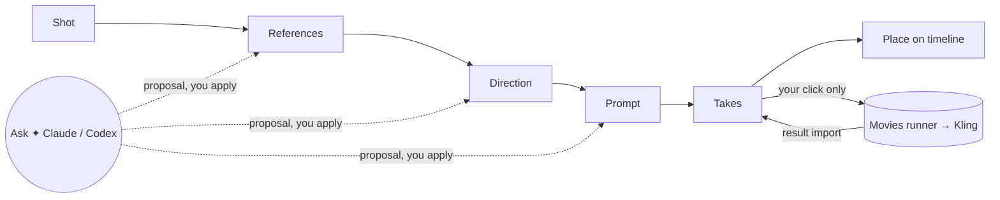

# Film Studio: a guided, connected workspace (plan)

> **For agentic workers:** REQUIRED SUB-SKILL: use superpowers:subagent-driven-development (recommended) or superpowers:executing-plans to carry out this plan task by task. Steps use checkbox (`- [ ]`) syntax for tracking.

**Goal:** a video maker opens Studio and is led through one shot at a time: what to do next, in plain words, with a hint on every control. They can ask Claude or Codex about any element on the page, and they can turn an approved shot into a Kling take, and the take into a timeline clip, without leaving Studio. Nothing spends money without their own click.

**Architecture:** the film panels read one film session store (zustand, the pattern Studio's player already uses). The store talks to new typed studio-server routes, `/projects/:id/film/*` and `/projects/:id/assistant/*`. The CLI host wires three ports behind those routes: the film project ledger, an assistant host (Codex and Claude, both through the person's own signed-in CLIs) and a Kling release port that calls the canonical Movies runner. The browser never holds credentials, and never submits.

**Tech stack:** React 19, zustand 5, Base UI primitives in `packages/studio/src/components/ui`, Hono (studio-server), vitest + happy-dom, oxlint/oxfmt, fallow. Bun for scripts.

**Spec / prior design:** `film-studio/PRODUCTION-DESIGN.md` (sections "Assistant host and subscription constraints", "API and editing integration"), `film-studio/PROJECT-CONTROL.md`. Survey evidence for this plan: three audits run on 2026-10-31 against `main` at `4c4691d67`. They covered UI/UX, React code quality, and the Claude/Codex/Kling wiring. Findings are summarised in "Where we are" below.

---

## Decisions (decided in the Inbox, 2026-10-31)

All four were accepted as recommended (Inbox msg_01M69DWXH2PE9ATGHB455PC70S). Phase 1 runs subagent-driven. Phases 1 and 2 do not depend on these decisions; Phases 3 and 4 do.

| #   | Decision                   | Decided                                                                                                                                                                                                  | What changes                                                                                                                                      |
| --- | -------------------------- | -------------------------------------------------------------------------------------------------------------------------------------------------------------------------------------------------------- | ------------------------------------------------------------------------------------------------------------------------------------------------- |
| D1  | Claude inside Studio       | Run **your installed, signed-in `claude` CLI** in proposal-only mode (tools, MCP and hooks off). Keep copy handoff as the fallback.                                                                      | Revises `PRODUCTION-DESIGN.md` ("Claude remains … external handoff"). No new login, no token extraction, and never API billing.                   |
| D2  | Kling spend                | Studio shows the exact take (prompt, references, model, seconds, credits). **Your click on "Approve and generate"** writes a one-job, short-lived approval, and Studio runs the canonical Movies runner. | Studio becomes a caller of `kling_release.py` and `kling_batch.py`. The runner stays the only submitter. An assistant can never press the button. |
| D3  | Prompt wording source      | tbc-forge presets and its Kling renderer (the director-approved wording) as a library Studio imports.                                                                                                    | Links the two repos. The fork's deleted compiler stays deleted.                                                                                   |
| D4  | The separate inspector app | Fold its review and job steps into Studio panels. Retire it once they match.                                                                                                                             | One design system instead of three.                                                                                                               |

---

## Where we are (survey, `main` @ `4c4691d67`)

- **Two film tabs, both on a stub.**
  - Production and Assistant are wired to `useFilmSession.ts:6-58`. That stub always reads "No shot connected". Prepare and Send only show a toast; only Copy handoff works.
  - Neither tab is in the default dock (`components/dock/dockLayout.ts:12`). The only way in is the Window menu.
- **Every real step is elsewhere.** Import, review, references, jobs, the Kling handoff and placement are CLI scripts or a separate vanilla-JS inspector (`film-studio/inspector/`). The inspector has its own light theme, and it loses review work unless you click Download.
- **Hard to read.**
  - Labels are jargon: "film ledger", "Compiled prompt", "Native parameters", "Kling CLI intent".
  - Options show internal values (`start-frame`, `separate-edit`).
  - Body text is 10–11px.
  - The whole panel is one long scroll with about 14 fields.
  - Blocked buttons look active.
  - Empty states give no way forward.
- **React quality.** The code is strictly typed and small. Its gaps:
  - Refs are written during render (`patternPin.ts:13-15`, `visibleProposal.ts:33`).
  - A stale state copy (`NativeParameters.tsx:31`).
  - `memo` that never helps, because new closures are built every render.
  - Contract types re-declared in a weaker form (`types.ts:8-42`).
  - Raw `<select>`/`<textarea>` used instead of `ui/Select`/`ui/Input`.
  - Deprecated `text-neutral-*` shim classes.
  - No unit tests for `briefEdit`, `sectionFields`, `nativeChoices` or `patternPin`.
- **Integration: none live.**
  - The proposal-only assistant host was deleted in `4c4691d67`.
  - Its Codex launcher hid the user's login: `isolatedProcessEnv` replaced `HOME`/`CODEX_HOME`.
  - Claude was handoff-only by policy.
  - There are no film or assistant routes in studio-server.
  - The only Kling path is the Movies runner (`kling_batch.py`). Its spend gate is `kling_release.py:118-135` `authorize()`.
  - Installed here: `codex-cli 0.166.0` ("Logged in using ChatGPT"), Claude Code `2.1.316`, `kling` on PATH.

---

## What the video maker will see

One panel per step, in the order the work happens. The panel **organises itself**:

- the step that needs you is open, at the top, with one primary action;
- finished steps fold to a one-line summary with a ✓;
- later steps stay folded, with a hint like "Comes after References".

```
┌ Production ─────────────────────────── IN-03 · "Andre at the table" ┐
│ ▶ Next: give the opening frame a reference                          │
│   The shot opens on Andre's hands. Pick the image Kling starts from.│
│   [ Choose opening frame ]                          Ask ✦           │
├─────────────────────────────────────────────────────────────────────┤
│ ✓ Shot          IN-03 · 6 s · 1 line                                │
│ ● References    2 of 3 roles filled                       Ask ✦     │
│     Who it is     andre-portrait-02.png        ⓘ                     │
│     Opening frame —  [ Choose… ]               ⓘ Kling starts here   │
│ ○ Direction     Comes after References                               │
│ ○ Prompt        Comes after Direction                                │
│ ○ Takes         Prepare a take once the prompt reads well            │
│ ○ Place         Put the chosen take on the timeline                  │
└─────────────────────────────────────────────────────────────────────┘
```

- **Hints everywhere, quietly.** Every control has a one-line hint in muted text and an ⓘ tooltip with an example. A blocked button stays visible, is `aria-disabled`, and says why underneath ("Needs an opening frame").
- **Ask ✦ on every element.** The shot, each reference, each prompt field, each warning and each take has an Ask button. It opens the Assistant with that element pinned as a context chip ("IN-03 › Opening frame"). Claude or Codex answers with a proposal. You see a diff and apply it per field, or not at all.
- **Plain words.** One glossary module maps every contract value to a label and a hint. `start-frame` becomes "Opening frame — the image Kling starts from".
- **Readable.** Studio's panel tokens and text-step scale: 12px minimum body, 13px headings, and Studio's `Section`, `Select`, `Input` and `Tooltip`. The token gate test keeps it that way.
- **Takes.**
  1. "Prepare take" shows exactly what Kling will receive and what it costs.
  2. "Approve and generate" is your click.
  3. Progress shows as plain status ("Queued at Kling · 2 min").
  4. Results land as takes you compare side by side. "Use this take" places it on the timeline through Studio's normal undoable edit.



---

## Global constraints (every task)

- TypeScript strict. No `any`, no `as T` (only `as const`). Narrow with type guards and the contract `parse*` functions.
- `/mnt/data/Projects_SSD/Movies_Projects` is read-only input. D2 adds a single, explicit exception, the approval record your click writes, and only if you accept D2.
- No paid call in any test. No network in tests. The Kling port is tested against a fake runner executable.
- An assistant proposal never approves, selects, releases or submits (`PROJECT-CONTROL.md:35`). Approve and generate is reachable only from a real pointer or keyboard activation in the Production panel. It is not exposed through WebMCP, assistant tools, the selection API or any URL a model can produce.
- Never set, read or forward `ANTHROPIC_API_KEY`, `OPENAI_API_KEY` or any `*API_KEY*` to an assistant process. Subscription logins come from the person's real `HOME`.
- Use primitives from `packages/studio/src/components/ui` only. No raw `<select>`/`<textarea>` in `film/`.
- Use `studioApiFetch` for every request (`.oxlintrc.json` already bans raw `fetch` in Studio).
- Tests: `cd packages/studio && bunx vitest run src/film`. Bare `bun test` is the wrong runner here (`packages/studio/AGENTS.md`). Lint and format changed files before each commit. Use conventional commits.
- One published branch, `main`. Work in a local worktree; the coordinator integrates (`PROJECT-CONTROL.md`).

## Review focus (failure modes no test covers today)

1. **A proposal lands on the wrong shot.** A turn starts on IN-03, the person switches to IN-04, and the proposal arrives and applies to IN-04. _Test:_ Task 3.4, "late proposal for a frozen context is shown as belonging to IN-03 and cannot apply to IN-04".
2. **Generation without a human click.** A WebMCP call, an assistant event, a double click or a retried request submits twice or with no click. _Tests:_ Task 4.3, "approve route refuses a request without a fresh UI confirmation bound to the payload hash" and "a double activation submits once".
3. **Silent API billing.** An `*_API_KEY` in the environment makes Claude or Codex bill an API account instead of the subscription. _Test:_ Task 3.1, "assistant env drops every `*API_KEY*` and keeps `HOME`".
4. **StrictMode re-render loses or resurrects state.** A double render forgets the pinned pattern or shows a hidden proposal again. _Test:_ Task 1.3, both hooks under `<StrictMode>`.
5. **A draft overwrites newer work.** Autosave of a brief overwrites a revision written by another window or by import. _Test:_ Task 2.3, "save with a stale expected revision returns conflict and keeps both versions".

---

## Phase 1: clean foundation and the guided panel (offline, no decisions needed)

Everything here works on the stub session, so it ships before any integration.

### Task 1.1: one source of truth for film types

**Files:**

- Modify: `packages/film-production/src/browser.ts`
- Modify: `packages/studio/src/film/types.ts`, `packages/studio/src/film/contractTypes.ts`
- Test: `packages/studio/src/film/types.test.ts`

**Interfaces:**

```ts
// browser.ts — add to the type export list
type ReferenceRole, type SoundStrategyV1, type ProjectShotViewV1,
type AssistantReadinessStateV1, type AssistantProviderV1, type SceneReferenceBindingV1,

// types.ts
export interface ShotReference {
  id: string;
  role: ReferenceRole;
  sha256: string;
  mediaKind: SceneReferenceBindingV1["mediaKind"];
}
export interface ProductionShot extends Omit<ProjectShotViewV1, "referenceIds" | "selectedCandidateId"> {
  references: ShotReference[];
}
export type AssistantReadinessView = AssistantReadinessV1;
```

- [ ] **Step 1: write the failing test.**

```ts
import { describe, expectTypeOf, it } from "vitest";
import type { AssistantReadinessV1, ReferenceRole } from "@hyperframes/film-production/browser";
import type { AssistantReadinessView, ShotReference } from "./types";

describe("film view types follow the contracts", () => {
  it("uses the contract role and readiness unions", () => {
    expectTypeOf<ShotReference["role"]>().toEqualTypeOf<ReferenceRole>();
    expectTypeOf<AssistantReadinessView>().toEqualTypeOf<AssistantReadinessV1>();
  });
});
```

- [ ] **Step 2:** `bunx vitest run src/film/types.test.ts --typecheck`. Expect a failure: `ReferenceRole` is not exported.
- [ ] **Step 3:** add the exports, retype `types.ts`, and make `contractTypes.ts` re-export `ReferenceRole` and `SoundStrategyV1` (drop the indexed-access copies). In `useFilmSession.ts`, give `READINESS` `provider: "claude-external"` so it type-checks against the union.
- [ ] **Step 4:** re-run the test plus `bun run --filter @hyperframes/studio typecheck`. Expect PASS.
- [ ] **Step 5:** `git commit -m "refactor(film): type the panels from the film contracts"`

### Task 1.2: plain-language glossary

**Files:**

- Create: `packages/studio/src/film/glossary.ts`
- Test: `packages/studio/src/film/glossary.test.ts`

**Interfaces:**

```ts
export interface Term {
  label: string;
  hint: string;
}
export const REFERENCE_ROLE_TERMS: Record<ReferenceRole, Term>;
export const SOUND_STRATEGY_TERMS: Record<SoundStrategyV1, Term>;
export const READINESS_TERMS: Record<AssistantReadinessStateV1, Term & { action: string | null }>;
export const SECTION_TERMS: Record<PromptSectionId, Term>;
```

`Record<Union, …>` makes the compiler refuse a missing value. The test also guards the wording.

- [ ] **Step 1: failing test.**

```ts
import { REFERENCE_ROLES, SOUND_STRATEGIES } from "@hyperframes/film-production/browser";
import { describe, expect, it } from "vitest";
import { REFERENCE_ROLE_TERMS, SOUND_STRATEGY_TERMS } from "./glossary";

describe("glossary", () => {
  it.each([...REFERENCE_ROLES])("role %s reads as words", (role) => {
    const term = REFERENCE_ROLE_TERMS[role];
    expect(term.label).not.toMatch(/-/);
    expect(term.label).not.toBe(role);
    expect(term.hint.length).toBeGreaterThan(12);
  });
  it.each([...SOUND_STRATEGIES])("sound %s reads as words", (value) => {
    expect(SOUND_STRATEGY_TERMS[value].label).not.toMatch(/-/);
  });
});
```

- [ ] **Step 2:** run it; expect FAIL (no module).
- [ ] **Step 3:** write the terms. Examples:
  - `identity` → "Who it is" / "Locks the face and body Kling keeps across the shot."
  - `start-frame` → "Opening frame" / "The image Kling starts from."
  - `exclusion` → "Keep out" / "Something that must not appear."
  - `separate-edit` → "Add sound in the edit".
  - Readiness `missing-cli` → "Codex isn't installed", with action "Install Codex, then reopen".
  - Readiness `external-handoff` → "Claude works in your own session", with action "Copy for Claude".
- [ ] **Step 4:** PASS. **Step 5:** `git commit -m "feat(film): plain-language labels and hints for every film value"`

### Task 1.3: no render-phase ref writes

**Files:**

- Modify: `packages/studio/src/film/patternPin.ts`, `packages/studio/src/film/visibleProposal.ts`
- Test: `packages/studio/src/film/hooks.test.tsx`

**Interfaces:** the signatures stay the same. State moves from refs into `useState`, using React's "store information from previous renders" pattern: compare, then `setState` during render, guarded so it settles.

```ts
export function usePinnedPattern(shotKey: string) {
  const [pin, setPin] = useState<{ shotKey: string; patternId: ScenePatternId | null }>({
    shotKey,
    patternId: null,
  });
  if (pin.shotKey !== shotKey) setPin({ shotKey, patternId: null });
  const patternId = pin.shotKey === shotKey ? pin.patternId : null;
  const pick = useCallback((id: ScenePatternId) => setPin({ shotKey, patternId: id }), [shotKey]);
  return [patternId, pick] as const;
}

export function useVisibleProposal(contextLabel: string, proposal: SceneBriefV1 | null) {
  const [memory, setMemory] = useState<ProposalMemory>({ label: contextLabel, hidden: null });
  const next = resolveVisibleProposal(contextLabel, proposal, memory);
  if (next.memory.label !== memory.label || next.memory.hidden !== memory.hidden)
    setMemory(next.memory);
  return next.visible;
}
```

- [ ] **Step 1: failing tests under `<StrictMode>`.**
  - Pin a pattern, re-render with the same shot: it is kept. Change the shot: it is cleared.
  - A proposal hidden by a context switch stays hidden after a StrictMode double render. A new proposal object shows.
- [ ] **Step 2:** the run fails on the hidden-proposal case: today a StrictMode double render discards the ref write.
- [ ] **Step 3:** implement as above. **Step 4:** PASS, together with the existing `resolveVisibleProposal` case in `filmPanels.test.tsx`.
- [ ] **Step 5:** `git commit -m "fix(film): keep pattern pin and proposal memory in state, not render-time refs"`

### Task 1.4: Studio primitives, tokens, no stale copies

**Files:**

- Modify: `NativeParameters.tsx`, `ReferenceRoles.tsx`, `PromptSections.tsx`, `FieldControl.tsx`, `AssistantPanel.tsx`, `chrome.tsx`
- Test: `packages/studio/src/film/primitives.test.tsx`

- [ ] **Step 1: failing tests.**
  - (a) Render `NativeParameters` with brief A, then with brief B (B sets a different duration): the trigger shows B's value. This catches the stale `picked` copy.
  - (b) `document.querySelectorAll("select, textarea:not([data-ui-input])")` inside the Production panel is empty.
- [ ] **Step 2:** FAIL.
- [ ] **Step 3:** make these changes.
  - Delete `picked`. Each control reads `choice.selected` and commits through `ui/Select` `onCommit`. Option labels come from the glossary, and an option that can't be chosen shows `disabled` with its reason.
  - Textareas use `ui/Input` (multiline) styling: `fieldBase`/`fieldText`.
  - Replace `chrome.tsx`:
    - drop `Block` in favour of `Section` from `components/editor/propertyPanelPrimitives`;
    - swap the class strings to `text-panel-text-*`, `bg-panel-*`, `border-panel-border` and `text-step-*` (`styles/theme.css:259-334`);
    - no `text-neutral-*`, no `text-[10px]`.
- [ ] **Step 4:** PASS, plus `bunx vitest run src/styles/tokenGate.test.ts`.
- [ ] **Step 5:** `git commit -m "refactor(film): Studio Select, Input, Section and panel tokens; drop the stale choice copy"`

### Task 1.5: unit tests for the brief logic

**Files:**

- Test: `briefEdit.test.ts`, `sectionFields.test.ts`, `nativeChoices.test.ts` (all in `packages/studio/src/film/`)

- [ ] Cover these cases:
  - `withPattern` keeps every unrelated field.
  - A reference-role change and a sound-strategy change each emit a brief that `parseSceneBrief` accepts.
  - `EditableLine` writes only its own field.
  - `choicesForModel` rejects an unparseable number, and offers only the values the snapshot lists.
- [ ] Run; these lock current behaviour, so expect PASS. If one fails, it is a real bug: stop and report it before changing the code.
- [ ] `git commit -m "test(film): pin brief editing, section fields and native choices"`

### Task 1.6: the self-organising step list and Next card

**Files:**

- Create: `packages/studio/src/film/steps.ts` (pure), `packages/studio/src/film/NextStep.tsx`, `packages/studio/src/film/StepSection.tsx`
- Modify: `ProductionPanel.tsx`
- Test: `steps.test.ts`, extend `filmPanels.test.tsx`

**Interfaces:**

```ts
export type StepId = "shot" | "references" | "direction" | "prompt" | "takes" | "place";
export type StepState = "done" | "current" | "later" | "blocked";
export interface StepView {
  id: StepId;
  state: StepState;
  summary: string;
  hint: string;
  blockedBy: StepId | null;
}
export interface NextAction {
  step: StepId;
  title: string;
  hint: string;
  actionLabel: string;
}
export function planSteps(input: {
  shot: ProductionShot | null;
  brief: SceneBriefV1 | null;
  compilation: CompilationV1 | null;
  takes: number;
  placed: boolean;
}): { steps: StepView[]; next: NextAction | null };
```

- [ ] **Step 1: failing table test** for `planSteps`:
  - no shot → `next.step === "shot"`, every other step `later`;
  - a shot whose required roles are missing → `references` is current, and the hint names the missing role in glossary words;
  - a compilation with an error diagnostic → `prompt` is current, and the hint quotes the first diagnostic;
  - takes > 0 and not placed → `place` is current;
  - everything done → `next === null`, and the summary reads "Ready".
- [ ] **Step 2:** FAIL. **Step 3:** implement. `StepSection` wraps `Section`: `defaultCollapsed = state !== "current"`, a ✓/●/○ glyph with an `aria-label`, the summary on the header line, and the hint as muted text.
- [ ] **Step 4:** add a panel test: the stub session shows "Next: connect a film project" with one primary action, and no other section is open.
- [ ] **Step 5:** `git commit -m "feat(film): steps that fold when done and a single Next card"`

### Task 1.7: blocked means visibly blocked

**Files:**

- Create: `packages/studio/src/film/BlockedButton.tsx`
- Modify: `ProductionPanel.tsx`, `AssistantPanel.tsx`
- Test: `filmPanels.test.tsx`

**Interface:** `BlockedButton({ reason: string | null, ...ButtonProps })`. When `reason` is non-null it sets `aria-disabled="true"`, swallows activation, renders the reason under the button and wraps the button in `Tooltip label={reason}`.

- [ ] Failing test: on the stub, Prepare has `aria-disabled="true"`, the visible text "Needs a film project" sits next to it, and clicking it does not call `showToast`. Implement, PASS.
- [ ] `git commit -m "fix(film): blocked actions say why and stay inert"`

### Task 1.8: keyboard and reading

**Files:**

- Modify: `PatternChoice.tsx`
- Test: `filmPanels.test.tsx`

- [ ] Failing test: in the pattern radio group, ArrowDown/ArrowRight moves focus and selection to the next pattern, ArrowUp/ArrowLeft to the previous one, and focus wraps at the ends (roving `tabIndex`).
- [ ] Shorten the pattern help from 4 paragraphs to one line plus "More" (a `Popover`).
- [ ] Implement, PASS. `git commit -m "feat(film): arrow keys in pattern choice and one-line help"`

### Task 1.9: hooks lint for film

**Files:**

- Modify: `.oxlintrc.json` (add an override for `packages/studio/src/film/**` with `react-hooks/exhaustive-deps: error`)

- [ ] Run `bunx oxlint packages/studio/src/film`. Fix what it finds: stable callbacks via `useCallback` in `useFilmSession`, and remove the inert `memo`, or keep it only where props are now stable.
- [ ] `git commit -m "chore(film): enforce hook dependencies in the film panels"`

**Phase 1 acceptance:**

- The film panels render on the stub with the Next card, folded steps, plain labels, ≥12px text and inert blocked buttons.
- `bunx vitest run src/film src/styles/tokenGate.test.ts` passes.
- Typecheck, oxlint, oxfmt and fallow pass with no baseline growth.

---

## Phase 2: real data and one workspace (offline, no decisions needed)

Each task here gets its detailed TDD steps when Phase 1 is merged, because the server types it touches (`packages/studio-server/src/types.ts` `StudioApiAdapter`) should be read fresh at that point.

- **2.1 Film routes.** Add an optional `StudioApiAdapter.film` capability.
  - Routes: `GET /projects/:id/film/view` (a `ProjectViewV1`, parsed on the client with the contract parsers) and `POST /projects/:id/film/commands` (a `FilmCommandV1` with `expectedProjectRevision`).
  - Without the capability, both answer `{ available: false, reason }`, and the panel says so in plain words.
  - Wire the real ledger in `packages/cli/src/server/studioServer.ts`; Vite keeps a fake.
  - Add a same-origin session bootstrap that issues a mutation token, with Host/Origin checks (`PRODUCTION-DESIGN.md:90`).
- **2.2 Film session store.** Add `film/filmSessionStore.ts` (zustand) holding view, revision, selected shot, draft and pending request. Actions are stable, selectors fine-grained. `useFilmSession` becomes a thin selector hook.
- **2.3 Drafts that never overwrite.** Autosave runs 800 ms after the last edit with `save-scene-draft` and the expected revision. A conflict shows both versions side by side with "Keep mine / Keep theirs". _(Review focus 5.)_
- **2.4 Clip → shot.** When a timeline clip is selected, the Production panel follows it. The link is an explicit metadata lookup (a `data-film-shot` attribute written by assembly, checked against the ledger), never DOM id = shot key.
- **2.5 Film workspace.**
  - When the open project has film metadata, Production opens on the right and Assistant sits beside it. This follows the Slideshow auto-open pattern in `hooks/usePanelLayout.ts:38-43`.
  - Window → "Film workspace" restores the layout.
  - The first visit shows a three-line welcome in the Next card, with no modal tour.
- **2.6 Review and jobs in Studio** (if D4 = fold in).
  - Port the inspector's review actions and job ledger into a Takes step.
  - Reasons become optional, with suggested chips ("Wrong face", "Bad motion", "Good"); the inspector demanded a typed reason for every action.
  - Job ids are generated, not hand-typed.
  - Keep the inspector's skip link and live-region patterns.

**Phase 2 acceptance:** open a real imported film project in Studio. Click a clip and its shot appears. Edit direction, reload, and the edit is still there. Edit the same shot from two windows: the second save shows the conflict. All of this is covered by tests against a fixture ledger.

---

## Phase 3: Claude and Codex on every element (needs D1)

- **3.1 Assistant host (CLI side, `packages/cli/src/film/assistant/`).**
  - Port the shape of the deleted host (`git show 4c4691d67~1:packages/cli/src/film/assistant/host.ts`). It implements `AssistantPort` (`model.ts:512-517`) with argument arrays and no shell.
  - **Environment:** keep the real `HOME`/`CODEX_HOME`, which the old `isolatedProcessEnv` replaced and so hid the login. Drop every `*API_KEY*`. Run in an empty temporary working directory, with the context and references written there read-only.
  - **Codex:** `codex exec --json --skip-git-repo-check --sandbox read-only --cd <tmp> --output-schema <SceneBrief schema> <prompt>`. Readiness comes from `codex login status`, which prints "Logged in using ChatGPT" here.
  - **Claude (if D1 = in-app):** `claude -p --output-format stream-json` with tools, MCP servers and hooks turned off. Your login comes from your own `HOME`; never pass `--bare`, which skips the subscription.
  - The exact isolation flags are pinned by a qualification test against the installed version (`2.1.316`), not from memory. If isolation can't be proven, readiness says `external-handoff` and Copy for Claude still works.
  - **Tests:** a fake `codex` and a fake `claude` executable on a temporary PATH record their argv and env. Cases:
    - `*API_KEY*` is dropped and `HOME` is kept (review focus 3);
    - output that is not a valid `SceneBriefV1` becomes a diagnostic, never applied;
    - output that mentions approval, price or `"executable": true` is rejected;
    - cancel kills the process.
- **3.2 Assistant routes.**
  - Routes: `POST /projects/:id/assistant/turns`, `GET …/turns/:turnId/events?after=` (SSE) and `DELETE …/turns/:turnId`.
  - Turns are stored per project with a cursor, so a reload resumes the stream.
- **3.3 Ask ✦ everywhere.**
  - An `AskButton` (an `IconButton` with a tooltip such as "Ask about the opening frame") sits on the shot header, each reference row, each prompt field, each diagnostic and each take.
  - It sets `askTarget = { shotKey, element: { kind, id }, revision }` in the store and focuses the Assistant composer, which shows the target as a removable chip and suggests two starter questions for that element kind.
- **3.4 Proposals you apply.**
  - A proposal shows as a per-field diff: before in muted text, after in normal text, with Apply on each field and "Apply all".
  - Each turn freezes its context. If the shot or revision has changed, the proposal is labelled "From IN-03, rev 12" and Apply is blocked with the reason _(review focus 1)_.
  - Applying sends a `save-scene-draft` command; it never selects, approves or submits.
- **3.5 Readiness in plain words.** The Assistant header shows a provider switch (Codex / Claude). For each provider the glossary gives a one-line status and the action that fixes it.

**Phase 3 acceptance:** with fake CLIs, Ask on a reference produces a proposal that changes only that reference's prose. Switching shot mid-turn blocks Apply. A manual check with the real signed-in CLIs is recorded separately as evidence ("authenticated, not mocked"), as `PROJECT-CONTROL.md` requires.

---

## Phase 4: Kling takes from the panel (needs D2, D3)

- **4.1 Prompt and job from tbc-forge** (if D3).
  - Add `@tbc-forge/core` as a workspace or path dependency.
  - The Takes step calls `renderKlingJob` (`tbc-forge/packages/core/src/kling/render.ts:212`) and `validateKlingJobs` (`validate-job.ts:190`). Studio therefore shows the same wording and checks as `tbc prompt --explain`, including the never-full-face rule for historical figures.
- **4.2 Prepare take.** This is a read-only card listing:
  - the prompt (with the provenance of each sentence on hover);
  - the reference images as thumbnails;
  - model, seconds and credit estimate;
  - the validation result.
    The primary button stays blocked with its reason until validation passes.
- **4.3 Approve and generate.**
  - A real pointer or keyboard activation calls `POST /projects/:id/film/releases` with a one-time confirmation the panel minted for that exact payload SHA-256.
  - The host checks it and writes the single-job approval `kling_release.py` `authorize()` expects (`kind=kling_job_release`, matching `scope.payloadSha256`, `maxJobs: 1`, a short `expiresAt`). It then runs the canonical runner as a subprocess.
  - The route refuses: no confirmation, a reused confirmation, a mismatched hash, and any call from WebMCP or the assistant host.
  - The button locks on first activation _(review focus 2)_.
  - Tests use a fake runner on a temporary PATH and a temporary approvals directory.
- **4.4 Progress and results.**
  - Status is reconciled from the runner's job state and the credit ledger and shown in plain words.
  - An "unknown" outcome reconciles the same task before any retry, and a retry needs a new approval.
  - Finished media is imported as takes with their hashes.
- **4.5 Compare and place.**
  - Takes for a shot sit side by side (`VideoFrameThumbnail`, synced scrub).
  - "Use this take" is a human click. It selects the candidate and places it through Studio's existing undoable mutation path, never overwriting a human edit.

- **4.6 Opening frames and references from local ComfyUI (no credits).**
  - The person's own local ComfyUI server makes opening frames and reference stills. Kling stays for the video takes.
  - Settings name one ComfyUI base URL (loopback only) and one saved workflow JSON per use: "opening frame" and "reference still". Studio fills only the workflow's declared prompt, seed and input-image nodes.
  - Studio never starts, stops or installs ComfyUI and never loads or switches models. If the server is unreachable or the workflow's model is missing, the step is blocked with a plain reason ("ComfyUI is not running at <url>; start it, then retry").
  - Generation is a human click. Results land as candidate stills with their hash, workflow hash and seed. "Use as opening frame" or "Use as reference" is a second click; nothing is auto-selected.
  - Tests use a fake HTTP server for `/prompt`, `/history/:id` and `/view`; no network.

**Phase 4 acceptance:** with the fake runner, Prepare → Approve → progress → import → compare → place works end to end, and every refusal case in 4.3 has a test. The first real paid take is a separate step you run and witness, recorded as live evidence.

---

## Phase 5: one design system, honest docs

- Retire `film-studio/inspector/` once the Phase 2.6 parity checklist is green (if D4); remove its fallow baselines.
- Rewrite `film-studio/README.md` as a one-page "Making a shot" guide, with screenshots from the Phase 1–4 panels.
- Update `PRODUCTION-DESIGN.md` for D1 and D2, `TASKS.md` and the execution ledger with command, SHA and result for each claim.

---

## Self-review

- **Coverage of the request:**
  - intuitive / minimal → steps, Next card, folding (1.6);
  - good reading → glossary, tokens, ≥12px (1.2, 1.4);
  - self-organising → `planSteps` (1.6) and the film workspace (2.5);
  - hints → field hints, tooltips, blocked reasons (1.2, 1.7);
  - React quality → 1.1, 1.3–1.5, 1.9, 2.2;
  - Claude/Codex on every element → 3.1–3.5;
  - Kling → 4.1–4.5.
- **Types:** `ShotReference`, `StepView`, `NextAction` and `AssistantReadinessView` are used with the same names throughout. Contract names match `packages/film-production/src/model.ts`.
- **Review focus:** each of the five has a named test in its owning task (3.4, 4.3, 3.1, 1.3, 2.3).
- **Proportion:** Phase 1 is detailed to the step because it is unblocked. Phases 2–4 name files, interfaces and tests, and get step-level detail once their decisions are made and the server types are read fresh.
